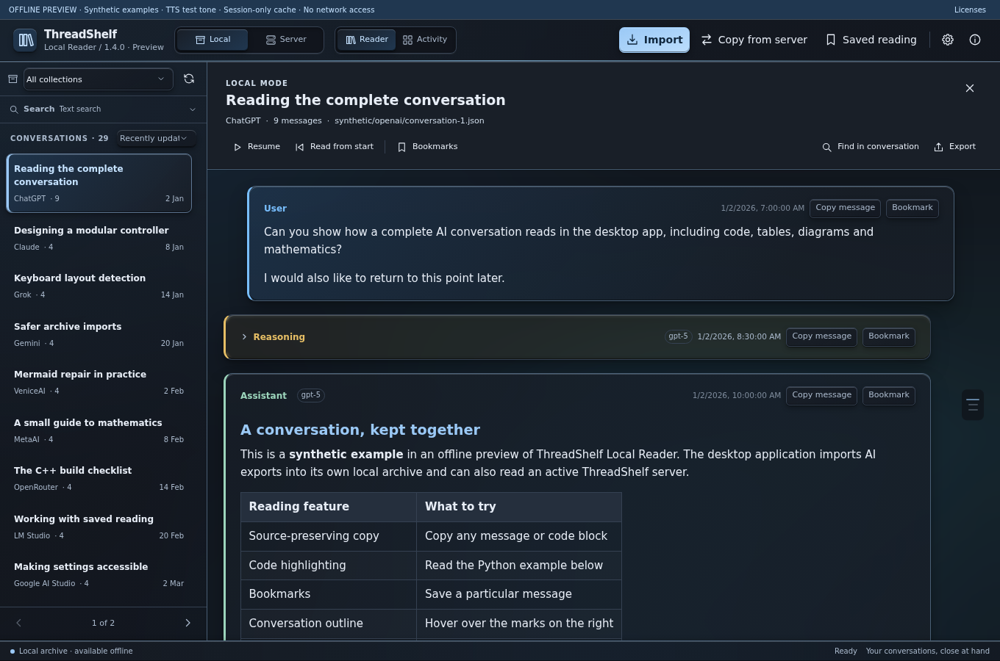
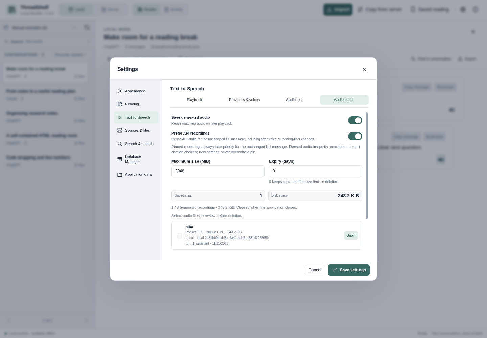
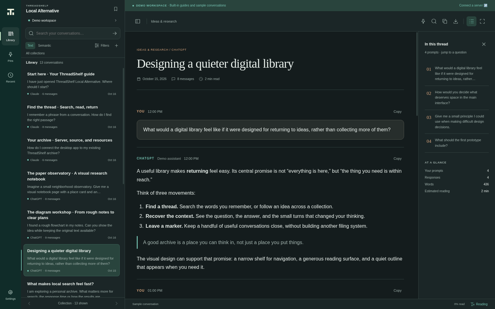
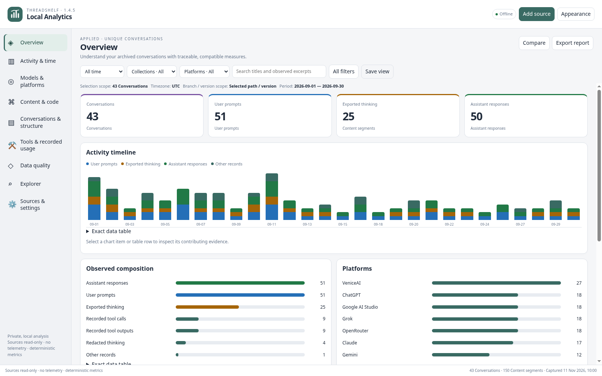

# ThreadShelf Local Suite

Desktop readers, local archive analytics, and a search integration patch for [ThreadShelf](https://github.com/ChrystianSchutz/ThreadShelf).

**Reader 1.4.2 · Analytics 1.4.2 · Alternative 1.4.2 · Windows x64 · GNU/Linux amd64**

Version **1.4.2** adds an **SVG / Code** toggle to eligible conversation code blocks in Reader and Alternative. Code remains the initial view, and Copy retains the original source in both views. All three desktop apps report **1.4.2**; Analytics functionality, profiles, archive formats, dependencies and runtime/toolchain pins are unchanged. The illustrated 1.4.0 manual and screenshots retain their original provenance; the new SVG controls are documented below and in the application READMEs. See the [changes](CHANGELOG.md), [validation record](maintainer/REVIEW-1.4.2.md), and [GitHub checks](https://github.com/Davoda1/ThreadShelf-Local-Suite/actions/workflows/checks.yml).

| Application | Choose it when you want… |
| --- | --- |
| **ThreadShelf Local Reader** | A full reading workspace with a local archive, optional server connection, search, rich conversation rendering, and extensive appearance settings. |
| **ThreadShelf Local Analytics** | Read-only analysis of a Reader archive through captures, filters, charts, relationships, and exportable reports. |
| **ThreadShelf Local Alternative** | A separate, focused server-reading interface with saved searches, pins, a prompt outline, and a built-in demonstration. |
| **Server patch** | Complete paginated search integration for the desktop clients on the exact supported upstream ThreadShelf 1.3.0 and 1.4.1 baselines. |

## Download and start

Choose one package for your application and operating system. These are direct file downloads; Node.js and npm are not needed to run the desktop apps.

| Application | Version | Windows x64 | Linux amd64 | Debian / Ubuntu amd64 |
| --- | --- | --- | --- | --- |
| **Reader** | **1.4.2** | [Portable ZIP](https://github.com/Davoda1/ThreadShelf-Local-Suite/releases/download/v1.4.2/ThreadShelf-Local-Reader-1.4.2-Windows-x64-Portable.zip) | [Portable TAR.GZ](https://github.com/Davoda1/ThreadShelf-Local-Suite/releases/download/v1.4.2/ThreadShelf-Local-Reader-1.4.2-Linux-amd64.tar.gz) | [DEB package](https://github.com/Davoda1/ThreadShelf-Local-Suite/releases/download/v1.4.2/threadshelf-local-reader_1.4.2_amd64.deb) |
| **Alternative** | **1.4.2** | [Portable ZIP](https://github.com/Davoda1/ThreadShelf-Local-Suite/releases/download/v1.4.2/ThreadShelf-Local-Alternative-1.4.2-Windows-x64-Portable.zip) | [Portable TAR.GZ](https://github.com/Davoda1/ThreadShelf-Local-Suite/releases/download/v1.4.2/ThreadShelf-Local-Alternative-1.4.2-Linux-amd64.tar.gz) | [DEB package](https://github.com/Davoda1/ThreadShelf-Local-Suite/releases/download/v1.4.2/threadshelf-local-alternative_1.4.2_amd64.deb) |
| **Analytics** | **1.4.2** | [Portable ZIP](https://github.com/Davoda1/ThreadShelf-Local-Suite/releases/download/v1.4.2/ThreadShelf-Local-Analytics-1.4.2-Windows-x64-Portable.zip) | [Portable TAR.GZ](https://github.com/Davoda1/ThreadShelf-Local-Suite/releases/download/v1.4.2/ThreadShelf-Local-Analytics-1.4.2-Linux-amd64.tar.gz) | [DEB package](https://github.com/Davoda1/ThreadShelf-Local-Suite/releases/download/v1.4.2/threadshelf-local-analytics_1.4.2_amd64.deb) |

Verify downloads with [1.4.2 SHA256SUM.txt](https://github.com/Davoda1/ThreadShelf-Local-Suite/releases/download/v1.4.2/SHA256SUM.txt). The [verification report](https://github.com/Davoda1/ThreadShelf-Local-Suite/releases/download/v1.4.2/ThreadShelf-Local-Suite-1.4.2-Verification.md) and [checksum instructions](maintainer/RELEASE.md#windows-checksum-verification) describe the tested files and their limits. The [1.3.0 dependency inventory](https://github.com/Davoda1/ThreadShelf-Local-Suite/releases/download/v1.3.0/ThreadShelf-Local-Suite-1.3.0-Version-Inventory.xlsx) remains the runtime/toolchain baseline; MathJax 4.1.3 remains in use, and the added speech dependencies are pinned in the [CPU speech asset manifest](apps/reader/tts/cpu/assets-manifest.json).

- **Windows:** extract the entire portable ZIP and run the application EXE at the extraction root. Keep the runtime files beside it.
- **Linux portable:** extract the TAR.GZ and run the extracted root `threadshelf-local-*` executable. Preserve the extracted directory structure and executable permissions.
- **Debian/Ubuntu:** install the appropriate `.deb` with `sudo apt install ./<package-name>.deb`, then launch it from the application menu.

The packages are unsigned. Linux needs the desktop libraries listed in the application's build/install guide. Analytics reads a compatible Reader archive or supported conversation exports; Alternative connects to a ThreadShelf server or runs the built-in synthetic demo. Semantic search requires the relevant search/embedding setup described in the manual.

### Try the interface

Download and open the self-contained [Reader 1.4.2 HTML preview](https://github.com/Davoda1/ThreadShelf-Local-Suite/releases/download/v1.4.2/ThreadShelf-Local-Reader-1.4.2-Preview.html) or [Alternative 1.4.2 HTML demo](https://github.com/Davoda1/ThreadShelf-Local-Suite/releases/download/v1.4.2/ThreadShelf-Local-Alternative-1.4.2-Demo.html) in a browser. They use synthetic examples and demonstrate the interface; native archive, server, disk-cache and speech operations require the desktop application.

## Interface gallery

Light and dark views of the public application renderers, captured with synthetic demonstration data. Click an image for its full resolution. [Capture details](docs/extras/SCREENSHOTS.md).

| Reader · dark conversation view | Reader · light speech-cache controls |
| --- | --- |
|  |  |

| Alternative · dark reading workspace | Analytics · light dashboard |
| --- | --- |
|  |  |

## Read the manual

- [Read the manual on GitHub](manual/content/index.md).
- [Built HTML manual files](docs/): download or clone the complete repository, then open `docs/index.html` locally.
- [Online user manual](https://davoda1.github.io/ThreadShelf-Local-Suite-Manual/).
- [Download the offline manual ZIP (1.4.0 content, bundled with 1.4.2)](https://github.com/Davoda1/ThreadShelf-Local-Suite/releases/download/v1.4.2/ThreadShelf-Local-Suite-1.4.2-Manual.zip).
- Offline: open `docs/index.html` in the source distribution, or `manual/index.html` in the combined release distribution.

The illustrated Gopher manual covers installation, first use, workflows, settings, speech playback and providers, charts, search, data management, troubleshooting, and the server patch. Screenshots use synthetic demonstration data. See the manual's screenshot provenance for the precise capture method.

The hosted manual is published from the separate [manual website repository](https://github.com/Davoda1/ThreadShelf-Local-Suite-Manual). That repository contains the generated documentation and required notices; the application sources and releases remain here.

## SVG code previews

Reader and Alternative offer an **SVG / Code** toggle for chat code blocks with no language tag or an `svg` or `xml` tag. Eligible blocks contain one complete, valid SVG document; whitespace and XML comments may appear before or after the root. Raw SVG, strict Base64 and `data:image/svg+xml;base64,` input are supported. HTML containing embedded SVG, extra prose or elements, malformed content and other language tags keep their code presentation.

Blocks start in Code view. Select **SVG** to show the image, then **Code** to return. Copy keeps its existing source text, including the original Base64 representation. Previews use isolated image rendering: scripts and external resources do not run or load. Existing code, math, Mermaid and speech controls retain their behavior. See the [Reader](apps/reader/README.md#reading-and-appearance) and [Alternative](apps/alternative/README.md#read-and-organize) guides.

## Speech playback

Reader and Alternative include Pocket TTS and Kokoro for local CPU speech. Their models and runtimes are bundled in the desktop packages; first use does not download a model or require a system Python installation. Optional provider connections send the selected spoken text to the configured service. Choose voices, streaming, speed, volume, text inclusion and audio-cache settings in the application's Text-to-Speech settings. Pinned recordings take priority for an unchanged full message; a default-on cache preference also keeps existing API audio when a different provider, voice or code/citation selection is chosen. Reused audio preserves the original reading, and pinned files are never overwritten. See the [manual](manual/content/index.md) for setup and privacy details.

## Server integration

Acquire ThreadShelf itself from [ChrystianSchutz/ThreadShelf](https://github.com/ChrystianSchutz/ThreadShelf). Read [server-patch/README.md](server-patch/README.md) before applying the supplied patcher. Separate [1.3.0](server-patch/1.3.0/README.md) and [1.4.1](server-patch/1.4.1/README.md) targets share the same root command. It checks the selected baseline, offers a dry run, backs up affected files, detects a previously applied patch, and supports rollback.

The 1.4.1 server target is available in the current `master` source tree; existing desktop release archives remain unchanged.

This repository contains the integration changes and patching tools. Configuration and archive data belong to each person's own server installation.

## Project structure

| Path | Purpose |
| --- | --- |
| `apps/reader/` | Reader source, tests, assets and native packaging tools |
| `apps/analytics/` | Analytics source, tests, assets and native packaging tools |
| `apps/alternative/` | Alternative source, offline renderer dependencies and native packaging tools |
| `server-patch/` | Versioned 1.3.0 and 1.4.1 integration patches, shared dispatcher and tests |
| `manual/` | Editable manual content, fresh screenshots and Gopher 3.0.0 publisher |
| `docs/` | Generated static user manual; README banner and screenshots in `docs/extras/` |
| `maintainer/` | GitHub setup, builds, release procedure and verification |
| `tools/` | Suite-level build and source verification helpers |

## Build or publish

Start with [maintainer/BUILD.md](maintainer/BUILD.md). The suite pins Node.js **24.22.1** and a [managed npm **12.2.1** toolchain with bundled Undici **6.29.1**](maintainer/NPM-TOOLCHAIN.md) for development builds. Electron is pinned separately for each application; the embedded Node.js is part of that runtime.

### Watch the build

Watch the real terminal build of Reader **1.2.0**, Analytics **1.0.0**, and Alternative **1.2.0** from commit [`c1030b0f0143`](https://github.com/Davoda1/ThreadShelf-Local-Suite/commit/c1030b0f014332a9b746ed4e2d93cd672bcb2a09). The recording covers dependency installation, tests, all nine Windows/Linux packages, archive validation, and SHA-256 checks.

https://github.com/user-attachments/assets/d106addb-9198-4d61-bad0-ac57cf7db4f5

[Download the MP4](docs/extras/ThreadShelf-Local-Suite-Real-Build-125x30.mp4?raw=1) · [Interactive recording on asciinema](https://asciinema.org/a/1270177) · [Download the asciinema cast](docs/extras/ThreadShelf-Local-Suite-Real-Build-125x30.cast?raw=1)

The 125×30 terminal capture preserves the original timing; the matching video is 1080p at 30 fps. The recorded run passed **951 tests**, skipped **4**, and verified all nine packages. Windows packages were cross-built on Linux; native Windows GUI execution is not shown. One public dependency-maintainer contact address is masked for publication.

### Publishing

For the repository owner, [maintainer/GITHUB-SETUP.md](maintainer/GITHUB-SETUP.md) explains the first upload, repository description/settings, private Git commit email, Pages, Actions and release assets. The included workflows build artifacts; publication is a separate maintainer action.

## Independence and attribution

ThreadShelf Local Suite is an independent companion project maintained by **davoda1**. It is not a fork of the upstream server and does not imply upstream endorsement. ThreadShelf server code is maintained by the original project. The integration patch identifies the upstream base and preserves applicable notices.

Original suite code is available under the [MIT license](LICENSE), `Copyright (c) 2026 davoda1`. Third-party components, fonts, codecs, rendering libraries, and runtime files retain their own terms. See [THIRD-PARTY-NOTICES.md](THIRD-PARTY-NOTICES.md) and each application's included notices/source offers.

### Sources and shared components

| Download | Version | Contents |
| --- | --- | --- |
| [Suite Source ZIP](https://github.com/Davoda1/ThreadShelf-Local-Suite/releases/download/v1.4.2/ThreadShelf-Local-Suite-1.4.2-Source.zip) · [Source TAR.GZ](https://github.com/Davoda1/ThreadShelf-Local-Suite/releases/download/v1.4.2/ThreadShelf-Local-Suite-1.4.2-Source.tar.gz) | 1.4.2 | Exact tagged application source, build tools, tests, notices, manual and server patch |
| Runtime sources: [part 01](https://github.com/Davoda1/ThreadShelf-Local-Suite/releases/download/v1.3.0/ThreadShelf-Local-Suite-1.3.0-Runtime-Sources-01.zip) · [part 02](https://github.com/Davoda1/ThreadShelf-Local-Suite/releases/download/v1.3.0/ThreadShelf-Local-Suite-1.3.0-Runtime-Sources-02.zip) · [part 03](https://github.com/Davoda1/ThreadShelf-Local-Suite/releases/download/v1.3.0/ThreadShelf-Local-Suite-1.3.0-Runtime-Sources-03.zip) · [part 04](https://github.com/Davoda1/ThreadShelf-Local-Suite/releases/download/v1.3.0/ThreadShelf-Local-Suite-1.3.0-Runtime-Sources-04.zip) · [part 05](https://github.com/Davoda1/ThreadShelf-Local-Suite/releases/download/v1.3.0/ThreadShelf-Local-Suite-1.3.0-Runtime-Sources-05.zip) · [part 06](https://github.com/Davoda1/ThreadShelf-Local-Suite/releases/download/v1.3.0/ThreadShelf-Local-Suite-1.3.0-Runtime-Sources-06.zip) · [metadata/assembler](https://github.com/Davoda1/ThreadShelf-Local-Suite/releases/download/v1.3.0/ThreadShelf-Local-Suite-1.3.0-Runtime-Sources-Metadata.zip) | Electron 45.1.0 | Complete selected Linux x64/Windows x64 source collection, supplemental sources and release profiles |
| ONNX sources: [part 01](https://github.com/Davoda1/ThreadShelf-Local-Suite/releases/download/v1.3.0/ThreadShelf-Local-Suite-1.3.0-ONNX-Sources-01.zip) · [part 02](https://github.com/Davoda1/ThreadShelf-Local-Suite/releases/download/v1.3.0/ThreadShelf-Local-Suite-1.3.0-ONNX-Sources-02.zip) · [metadata/assembler](https://github.com/Davoda1/ThreadShelf-Local-Suite/releases/download/v1.3.0/ThreadShelf-Local-Suite-1.3.0-ONNX-Sources-Metadata.zip) | ONNX 1.31.1 | Native/Web/common source, active dependency closure, original recipes and verification |
| [Native-Sources TAR.GZ](https://github.com/Davoda1/ThreadShelf-Local-Suite/releases/download/v1.0.0/ThreadShelf-Local-Suite-1.0.0-Native-Sources.tar.gz) | 1.0.0, unchanged scope | Reused sharp 0.35.5/libvips 8.18.7 source material only; original provenance limits retained |

Normal installation needs only an application package. For source access, keep every numbered part and the corresponding metadata ZIP. Extract the metadata ZIPs; the offline assemblers read the numbered source ZIPs directly. Use the [1.4.2 checksum manifest](https://github.com/Davoda1/ThreadShelf-Local-Suite/releases/download/v1.4.2/SHA256SUM.txt) for new application assets, the [1.3.0 checksum manifest](https://github.com/Davoda1/ThreadShelf-Local-Suite/releases/download/v1.3.0/SHA256SUM.txt) for the unchanged Runtime/ONNX source companions, and the [original 1.0.0 checksum manifest](https://github.com/Davoda1/ThreadShelf-Local-Suite/releases/download/v1.0.0/SHA256SUM.txt) for the unchanged Native-Sources download. Preserve matching sources, original notices and rebuild instructions alongside redistributed binaries. Rebuilding also needs the documented compilers, SDKs and build utilities; a complete binary rebuild or byte-identical reproduction is not claimed. See [source verification](maintainer/RUNTIME-SOURCE-PREPARATION.md), [runtime source access](apps/reader/licenses/ELECTRON-SOURCE-ACCESS.md), and [ONNX source access](apps/reader/licenses/ONNX-SOURCE-ACCESS.md).

## Help and contributions

Read the troubleshooting chapters, then [open an issue](https://github.com/Davoda1/ThreadShelf-Local-Suite/issues) with a minimal synthetic reproduction. Do not attach real conversation archives, access tokens, private URLs or personal configuration. See [CONTRIBUTING.md](CONTRIBUTING.md) and [SECURITY.md](SECURITY.md).
