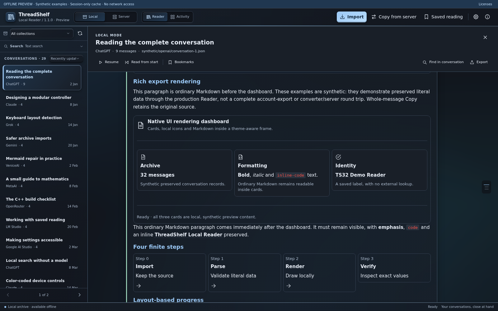
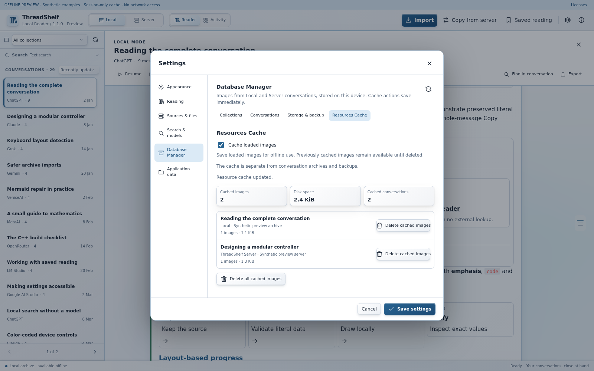
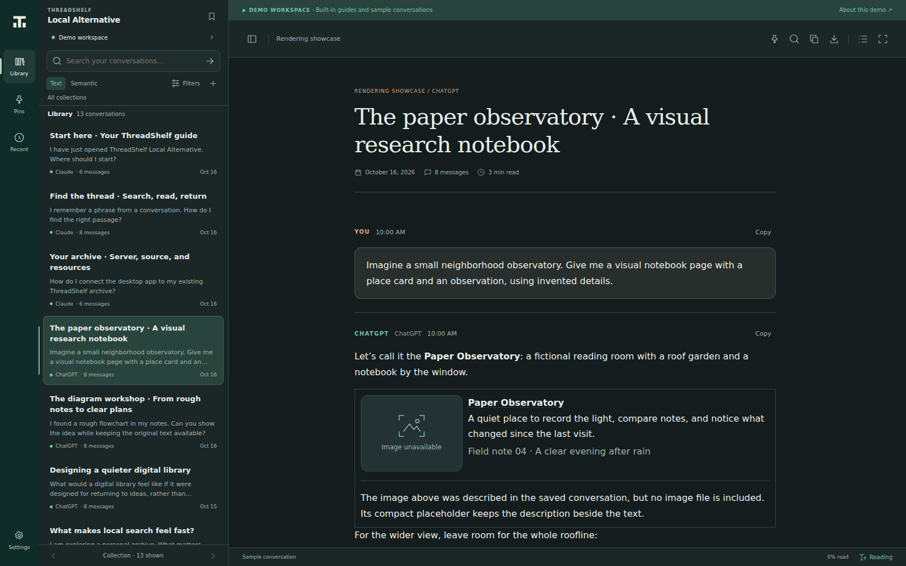
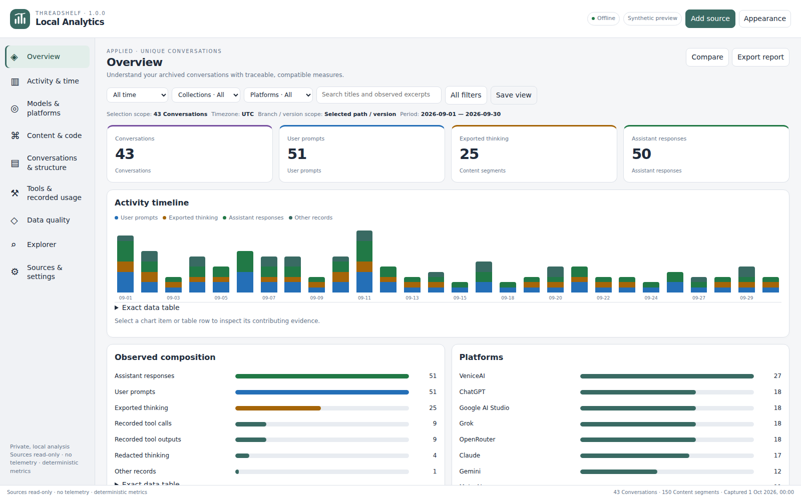

# ThreadShelf Local Suite

Desktop readers, local archive analytics, and a search integration patch for [ThreadShelf](https://github.com/ChrystianSchutz/ThreadShelf).

**Reader 1.2.0 · Alternative 1.2.0 · Analytics 1.0.0 · Windows x64 · GNU/Linux amd64**

Reader and Alternative **1.2.0** format useful JSON-only responses as highlighted, indented code while preserving the original text for copy and export. They also improve startup from paths containing special characters. Existing image controls and Reader’s independent image cache are retained. Analytics remains **1.0.0**, and the manual and server patch are unchanged. The download table below selects the current version of each component across the current and earlier releases. See the [1.2.0 changes](CHANGELOG.md), [validation scope](maintainer/REVIEW-1.2.0.md) and [GitHub checks](https://github.com/Davoda1/ThreadShelf-Local-Suite/actions/workflows/checks.yml).

| Application | Choose it when you want… |
| --- | --- |
| **ThreadShelf Local Reader** | A full reading workspace with a local archive, optional server connection, search, rich conversation rendering, and extensive appearance settings. |
| **ThreadShelf Local Analytics** | Read-only analysis of a Reader archive through captures, filters, charts, relationships, and exportable reports. |
| **ThreadShelf Local Alternative** | A separate, focused server-reading interface with saved searches, pins, a prompt outline, and a built-in demonstration. |
| **Server patch** | Complete paginated search integration for the desktop clients on the exact supported upstream ThreadShelf 1.3.0 baseline. |

## Download and start

Choose one package for your application and operating system. These are direct file downloads; Node.js and npm are not needed to run the desktop apps.

| Application | Version | Windows x64 | Linux amd64 | Debian / Ubuntu amd64 |
| --- | --- | --- | --- | --- |
| **Reader** | **1.2.0** | [Portable ZIP](https://github.com/Davoda1/ThreadShelf-Local-Suite/releases/download/v1.2.0/ThreadShelf-Local-Reader-1.2.0-Windows-x64-Portable.zip) | [Portable TAR.GZ](https://github.com/Davoda1/ThreadShelf-Local-Suite/releases/download/v1.2.0/ThreadShelf-Local-Reader-1.2.0-Linux-amd64.tar.gz) | [DEB package](https://github.com/Davoda1/ThreadShelf-Local-Suite/releases/download/v1.2.0/threadshelf-local-reader_1.2.0_amd64.deb) |
| **Alternative** | **1.2.0** | [Portable ZIP](https://github.com/Davoda1/ThreadShelf-Local-Suite/releases/download/v1.2.0/ThreadShelf-Local-Alternative-1.2.0-Windows-x64-Portable.zip) | [Portable TAR.GZ](https://github.com/Davoda1/ThreadShelf-Local-Suite/releases/download/v1.2.0/ThreadShelf-Local-Alternative-1.2.0-Linux-amd64.tar.gz) | [DEB package](https://github.com/Davoda1/ThreadShelf-Local-Suite/releases/download/v1.2.0/threadshelf-local-alternative_1.2.0_amd64.deb) |
| **Analytics** | **1.0.0** | [Portable ZIP](https://github.com/Davoda1/ThreadShelf-Local-Suite/releases/download/v1.0.0/ThreadShelf-Local-Analytics-1.0.0-Windows-x64-Portable.zip) | [Portable TAR.GZ](https://github.com/Davoda1/ThreadShelf-Local-Suite/releases/download/v1.0.0/ThreadShelf-Local-Analytics-1.0.0-Linux-amd64.tar.gz) | [DEB package](https://github.com/Davoda1/ThreadShelf-Local-Suite/releases/download/v1.0.0/threadshelf-local-analytics_1.0.0_amd64.deb) |

Verify downloads with the checksum manifest for their release: [1.2.0 SHA256SUM.txt](https://github.com/Davoda1/ThreadShelf-Local-Suite/releases/download/v1.2.0/SHA256SUM.txt) or [1.0.0 SHA256SUM.txt](https://github.com/Davoda1/ThreadShelf-Local-Suite/releases/download/v1.0.0/SHA256SUM.txt). [Verification instructions](maintainer/RELEASE.md#windows-checksum-verification) and the [1.2.0 validation report](https://github.com/Davoda1/ThreadShelf-Local-Suite/releases/download/v1.2.0/ThreadShelf-Local-Suite-1.2.0-Verification.md) describe the checks and their limits.

- **Windows:** extract the entire portable ZIP and run the application EXE at the extraction root. Keep the runtime files beside it.
- **Linux portable:** extract the TAR.GZ and run the extracted `bin/threadshelf-local-*` entry. Preserve the extracted directory structure and executable permissions.
- **Debian/Ubuntu:** install the appropriate `.deb` with `sudo apt install ./<package-name>.deb`, then launch it from the application menu.

The packages are unsigned. Linux needs the desktop libraries listed in the application's build/install guide. Analytics reads a compatible Reader archive or supported conversation exports; Alternative connects to a ThreadShelf server or runs the built-in synthetic demo. Semantic search requires the relevant search/embedding setup described in the manual.

### Try the interface

Download and open the self-contained [Reader 1.2.0 HTML preview](https://github.com/Davoda1/ThreadShelf-Local-Suite/releases/download/v1.2.0/ThreadShelf-Local-Reader-1.2.0-Preview.html) or [Alternative 1.2.0 HTML demo](https://github.com/Davoda1/ThreadShelf-Local-Suite/releases/download/v1.2.0/ThreadShelf-Local-Alternative-1.2.0-Demo.html) in a browser. They use synthetic examples and demonstrate the interface; native archive, server and disk-cache operations require the desktop application.

## Interface gallery

Light and dark views of the public application renderers, captured with synthetic demonstration data. Click an image for its full resolution. [Capture details](docs/extras/SCREENSHOTS.md).

| Reader · dark conversation view | Reader · light image-cache controls |
| --- | --- |
|  |  |

| Alternative · dark reading workspace | Analytics · light dashboard |
| --- | --- |
|  |  |

## Read the manual

- [Read the manual on GitHub](manual/content/index.md).
- [Built HTML manual files](docs/): download or clone the complete repository, then open `docs/index.html` locally.
- [Online user manual](https://davoda1.github.io/ThreadShelf-Local-Suite-Manual/).
- [Download the offline manual ZIP (1.0.0, unchanged)](https://github.com/Davoda1/ThreadShelf-Local-Suite/releases/download/v1.0.0/ThreadShelf-Local-Suite-1.0.0-Manual.zip).
- Offline: open `docs/index.html` in the source distribution, or `manual/index.html` in the combined release distribution.

The illustrated Gopher manual covers installation, first use, workflows, settings, charts, search, data management, troubleshooting, and the server patch. Screenshots use synthetic demonstration data. See the manual's screenshot provenance for the precise capture method.

The hosted manual is published from the separate [manual website repository](https://github.com/Davoda1/ThreadShelf-Local-Suite-Manual). That repository contains the generated documentation and required notices; the application sources and releases remain here.

## Server integration

Acquire ThreadShelf itself from [ChrystianSchutz/ThreadShelf](https://github.com/ChrystianSchutz/ThreadShelf). Read [server-patch/README.md](server-patch/README.md) before applying the supplied patcher. It checks the supported baseline, offers a dry run, backs up affected files, detects a previously applied patch, and supports rollback.

This repository contains the integration changes and patching tools. Configuration and archive data belong to each person's own server installation.

## Project structure

| Path | Purpose |
| --- | --- |
| `apps/reader/` | Reader source, tests, assets and native packaging tools |
| `apps/analytics/` | Analytics source, tests, assets and native packaging tools |
| `apps/alternative/` | Alternative source, offline renderer dependencies and native packaging tools |
| `server-patch/` | Version-bound integration patch, patcher and tests |
| `manual/` | Editable manual content, fresh screenshots and Gopher 3.0.0 publisher |
| `docs/` | Generated static user manual; README banner and screenshots in `docs/extras/` |
| `maintainer/` | GitHub setup, builds, release procedure and verification |
| `tools/` | Suite-level build and source verification helpers |

## Build or publish

Start with [maintainer/BUILD.md](maintainer/BUILD.md). The suite pins Node.js **24.19.0** and npm **11.9.0** for development builds. Electron is pinned separately for each application; the embedded Node.js is part of that runtime.

### Watch the build

Watch the real terminal build of Reader **1.2.0**, Analytics **1.0.0**, and Alternative **1.2.0** from commit [`c1030b0f0143`](https://github.com/Davoda1/ThreadShelf-Local-Suite/commit/c1030b0f014332a9b746ed4e2d93cd672bcb2a09). The recording covers dependency installation, tests, all nine Windows/Linux packages, archive validation, and SHA-256 checks.

https://github.com/user-attachments/assets/d106addb-9198-4d61-bad0-ac57cf7db4f5

[Download the MP4](docs/extras/ThreadShelf-Local-Suite-Real-Build-125x30.mp4?raw=1) · [Interactive recording on asciinema](https://asciinema.org/a/1270177) · [Download the asciinema cast](docs/extras/ThreadShelf-Local-Suite-Real-Build-125x30.cast?raw=1)

The 125×30 terminal capture preserves the original timing; the matching video is 1080p at 30 fps. The recorded run passed **951 tests**, skipped **4**, and verified all nine packages. Windows packages were cross-built on Linux; native Windows GUI execution is not shown. One public dependency-maintainer contact address is masked for publication.

### Publishing

For the repository owner, [maintainer/GITHUB-SETUP.md](maintainer/GITHUB-SETUP.md) explains the first upload, repository description/settings, private Git commit email, Pages, Actions and release assets. The included workflows build artifacts; publication is a separate maintainer action.

## Independence and attribution

ThreadShelf Local Suite is an independent companion project maintained by **davoda1**. It is not a fork of the upstream server and does not imply upstream endorsement. ThreadShelf server code is maintained by the original project. The integration patch identifies the upstream base and preserves applicable notices.

Original suite code is available under the [MIT license](LICENSE), `Copyright (c) 2026 davoda1`. Third-party components, fonts, codecs, rendering libraries, and runtime files retain their own terms. See [THIRD-PARTY-NOTICES.md](THIRD-PARTY-NOTICES.md) and each application's included notices/source offers.

### Sources and shared components

| Download | Version | Contents |
| --- | --- | --- |
| [Suite Source ZIP](https://github.com/Davoda1/ThreadShelf-Local-Suite/releases/download/v1.2.0/ThreadShelf-Local-Suite-1.2.0-Source.zip) · [Source TAR.GZ](https://github.com/Davoda1/ThreadShelf-Local-Suite/releases/download/v1.2.0/ThreadShelf-Local-Suite-1.2.0-Source.tar.gz) | 1.2.0 | Current complete repository, including Analytics 1.0.0, build tools, tests, manual and the unchanged server patch |
| [Native-Sources TAR.GZ](https://github.com/Davoda1/ThreadShelf-Local-Suite/releases/download/v1.0.0/ThreadShelf-Local-Suite-1.0.0-Native-Sources.tar.gz) | 1.0.0, reused | Sources and build recipes for the unchanged native dependencies |
| Runtime-Sources: [part 01](https://github.com/Davoda1/ThreadShelf-Local-Suite/releases/download/v1.0.0/ThreadShelf-Local-Suite-1.0.0-Runtime-Sources-01.tar.gz) · [part 02](https://github.com/Davoda1/ThreadShelf-Local-Suite/releases/download/v1.0.0/ThreadShelf-Local-Suite-1.0.0-Runtime-Sources-02.tar.gz) · [part 03](https://github.com/Davoda1/ThreadShelf-Local-Suite/releases/download/v1.0.0/ThreadShelf-Local-Suite-1.0.0-Runtime-Sources-03.tar.gz) · [manifest](https://github.com/Davoda1/ThreadShelf-Local-Suite/releases/download/v1.0.0/RUNTIME-SOURCES.json) | 1.0.0, reused | Complete source companion for the unchanged pinned runtime; all three parts are required |

The runtime mirror contains the pinned Electron/Chromium Git dependency trees for Linux x64 and Windows x64, plus the source-bearing build material and release profiles described in its manifests. Preserve the current suite source, the shared source companions, notices and rebuild instructions alongside redistributed binaries. Normal installation needs only an application package; runtime rebuilding also needs the documented compiler, SDK and build utilities. See [runtime source access and rebuilding](apps/reader/licenses/ELECTRON-SOURCE-ACCESS.md).

## Help and contributions

Read the troubleshooting chapters, then [open an issue](https://github.com/Davoda1/ThreadShelf-Local-Suite/issues) with a minimal synthetic reproduction. Do not attach real conversation archives, access tokens, private URLs or personal configuration. See [CONTRIBUTING.md](CONTRIBUTING.md) and [SECURITY.md](SECURITY.md).
