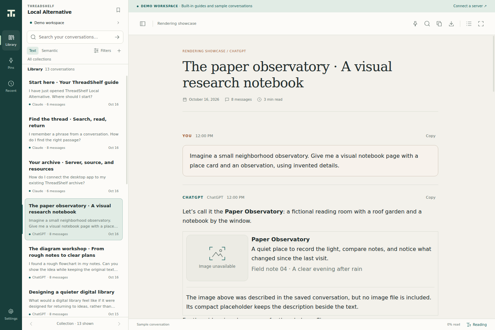
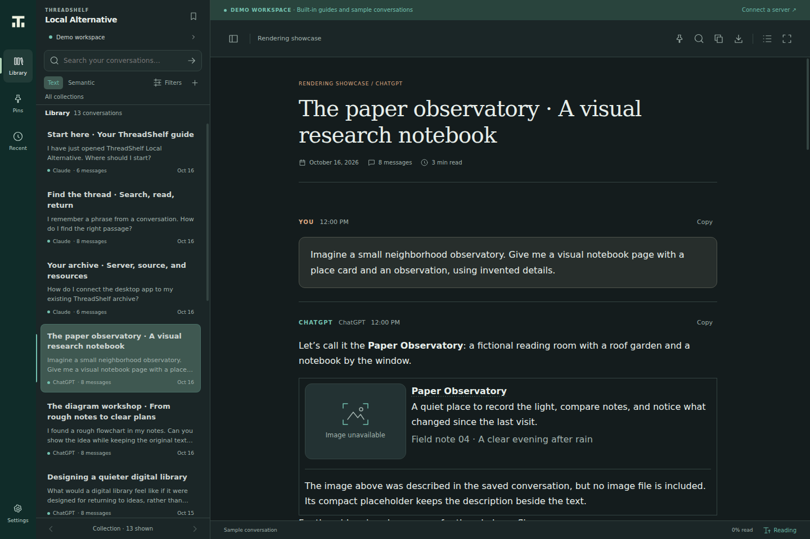
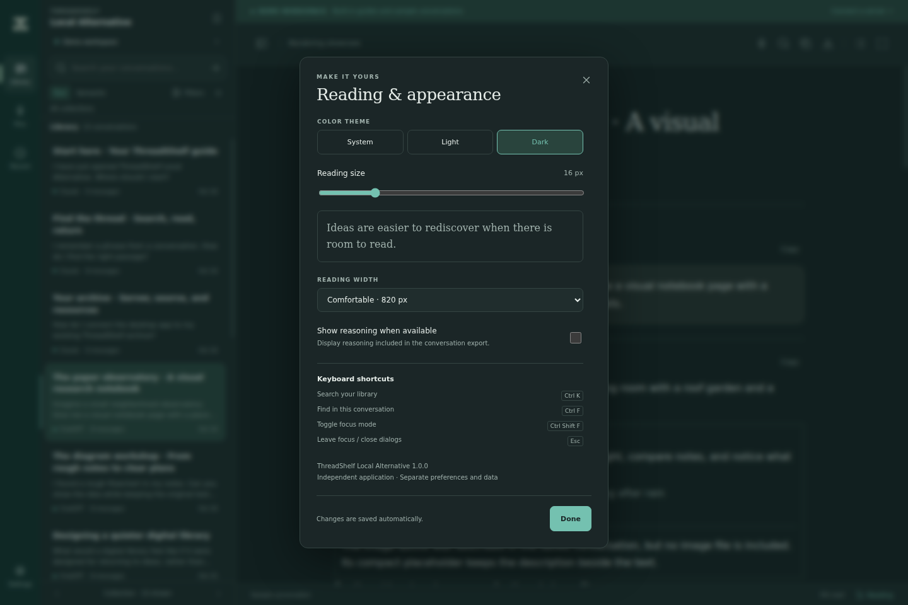
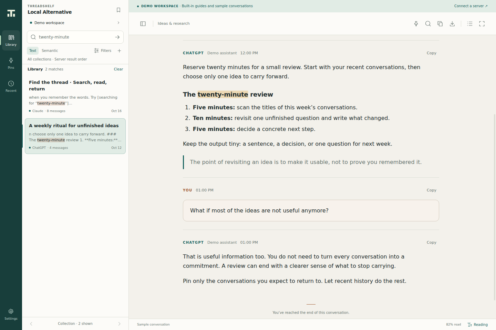
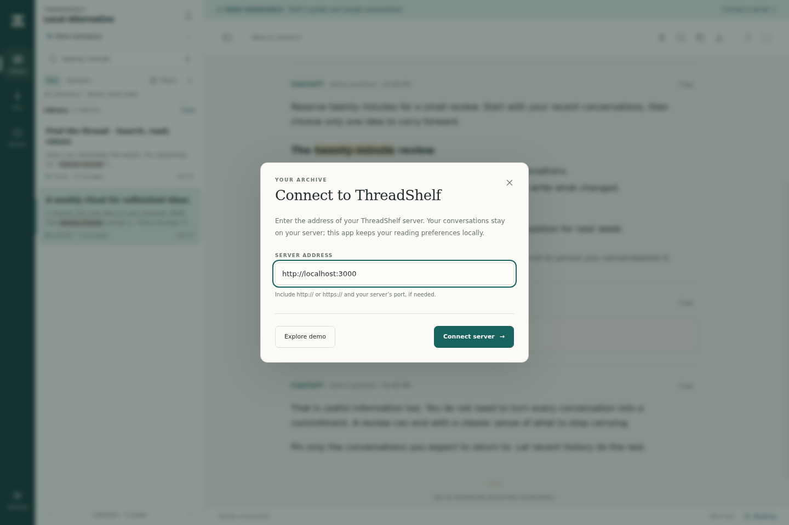

# Local Alternative 1.0.0 — screenshot guide

These fresh 1440 × 960 captures show the real Local Alternative 1.0.0 native Electron window on Linux, using only the built-in synthetic demo. The capture used Electron **44.4.5** in a virtual display; this is the historical capture environment. The final desktop packages use Electron **44.9.1**. No live server or personal archive was connected. The capture environment disabled the Chromium sandbox and bypassed the single-instance guard for automation; these are test accommodations, not recommended application launch settings. No renderer errors or HTTP(S) requests occurred.

## Reading in light and dark

The shelf and prompt outline support moving through conversations while the main pane keeps the selected thread visible. These are the same synthetic demo library in both palettes.

## Settings and version

Theme, reading size, reading width and exported-reasoning visibility are saved automatically. The settings footer shows the public version 1.0.0.

## Search and a matched passage

The synthetic text query has two results: a guide entry and a sample conversation. Search highlights help locate matching text in the selected thread. Live-server pagination and semantic ranking depend on the connected server and are not established by this demo image.

## Connection form

Enter the final base address of your own ThreadShelf server. The generic local example is not a shipped server instance. Follow the [connection guide](../Alternative/01-Connection-and-Workspace.md) and optional [1.3.0 search integration](../Server/index.md).

