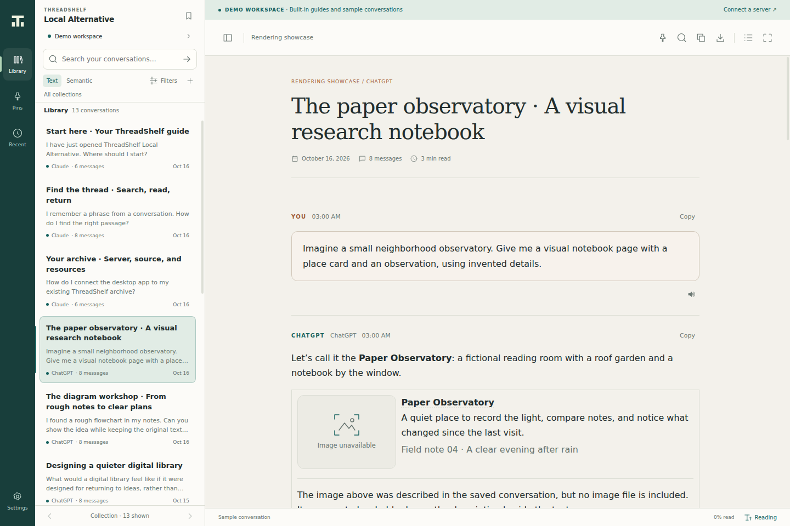
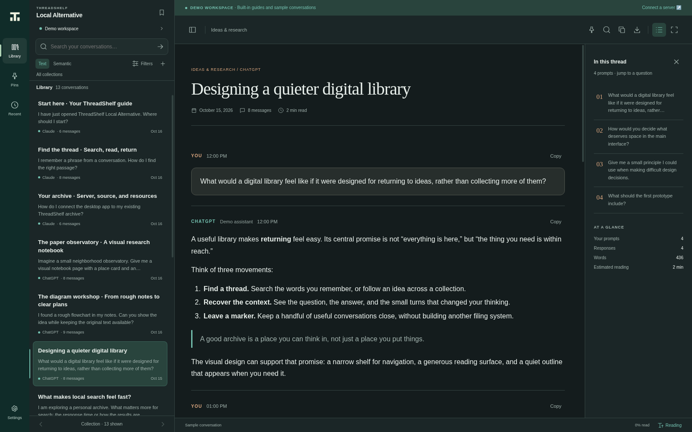
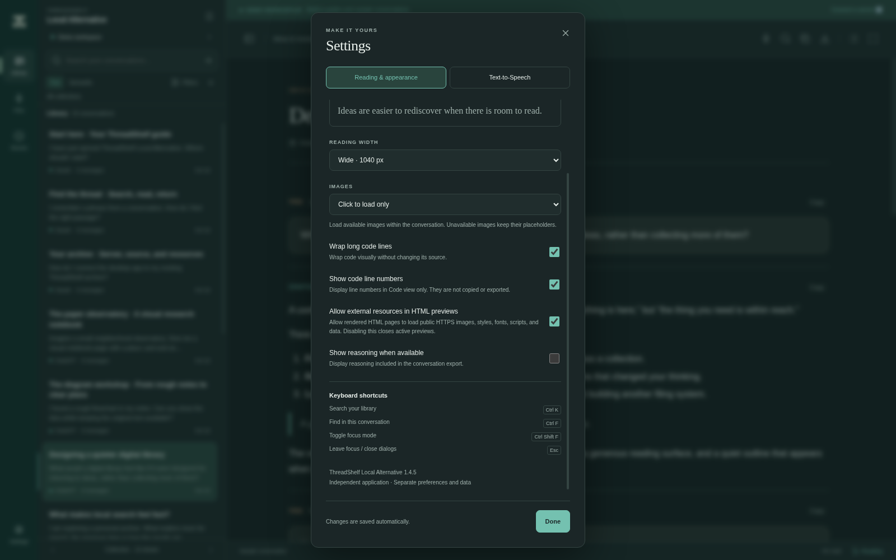
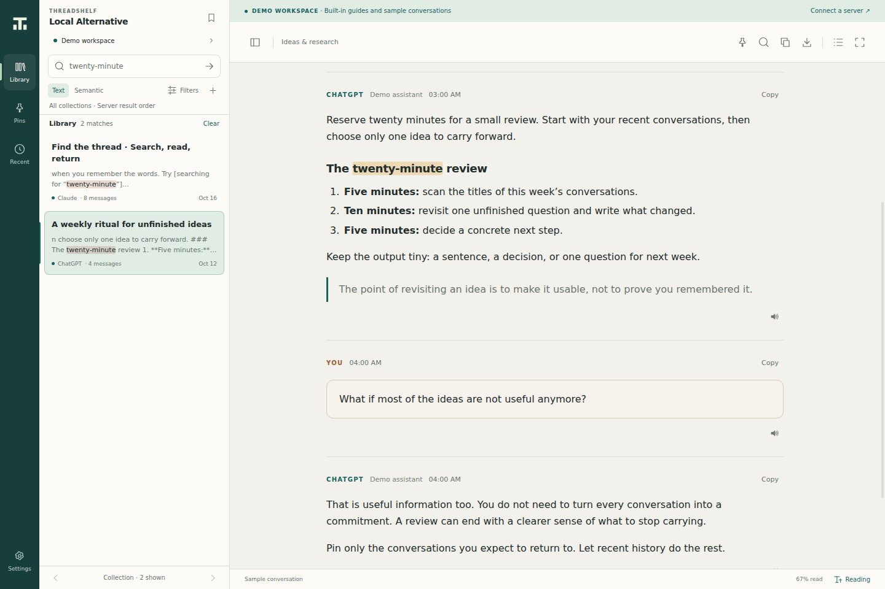
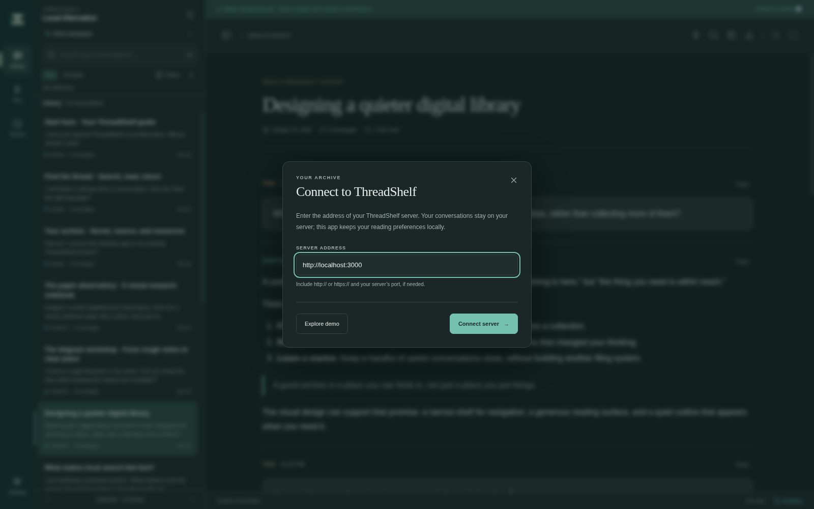
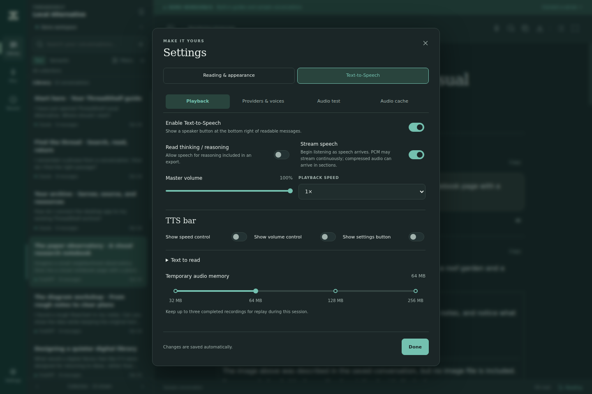
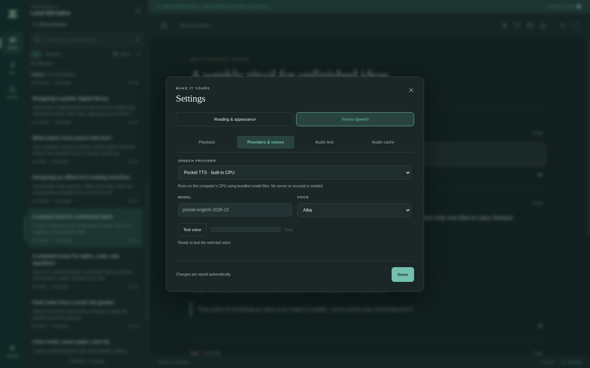
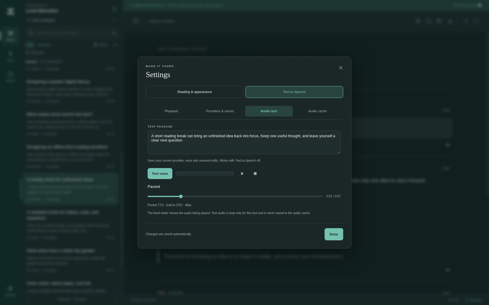
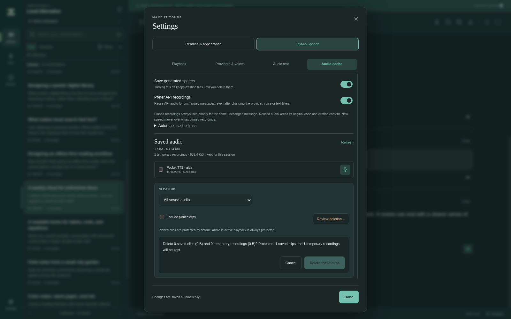

# Local Alternative 1.4.0 — screenshot guide

These 1440 × 960 captures show the real Local Alternative 1.4.0 native Electron window on Linux, using the built-in synthetic demo. The capture runtime is Electron **45.1.0**, matching the pinned desktop runtime. No live server or private archive was connected. The automated capture used a virtual display, disabled the sandbox and bypassed the single-instance guard; those are test accommodations, not recommended launch settings. The capture recorded no renderer errors or external HTTP(S) requests. Speech settings images show the controls and do not claim a successful remote-provider request.

## Reading in light and dark

The shelf and prompt outline support moving through conversations while the main pane keeps the selected thread visible. These are the same synthetic demo library in both palettes.

## Settings and version

Theme, reading size, reading width, image loading and exported-reasoning visibility are saved automatically. The Reading & appearance panel shows the public version 1.4.0.

## Search and a matched passage

The synthetic text query has two results: a guide entry and a sample conversation. Search highlights help locate matching text in the selected thread. Live-server pagination and semantic ranking depend on the connected server and are not established by this demo image.

## Connection form

Enter the final base address of your own ThreadShelf server. The generic local example is not a shipped server instance. Follow the [connection guide](../Alternative/01-Connection-and-Workspace.md) and optional [1.3.0 search integration](../Server/index.md).

## Text-to-Speech playback

The Playback section enables message speaker buttons and sets reasoning, streaming, volume, speed and optional bar controls. The TTS navigation remains above its scrolling content. See [Text-to-Speech](../Alternative/08-Text-to-Speech.md) for the automatic-save workflow.

## Providers and voice testing

Choose a bundled CPU voice or configure a compatible remote provider. The Audio test section uses a separate passage and player; its meter measures played output, without microphone input.

## Audio cache

Persistent audio caching is opt-in. Pinned recordings take priority for an unchanged full message and survive voice/provider changes; Prefer API recordings is on by default. Review deletion counts before cleanup; pinned clips are protected by default and active playback is always protected. Temporary session recordings and saved disk clips have separate totals.

