# Local Analytics 1.0.0 — screenshot guide

These new images show the exact compiled 1.0.0 application renderer with the built-in synthetic demo bridge, captured in UTC. The preview banner labels the demonstration. They are unaltered browser screenshots of the actual interface, not generated illustrations. Native file dialogs, imported personal profiles and operating-system packaging are not tested by these images.

## Overview: scope before interpretation

Overview summarizes the applied capture and selections. Review the scope summary before comparing a card or chart. Light and dark use the same sample population.

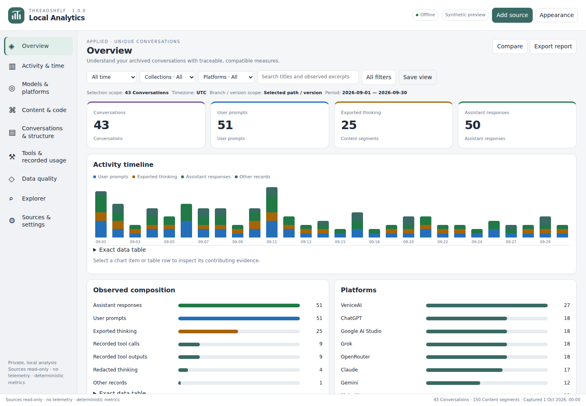

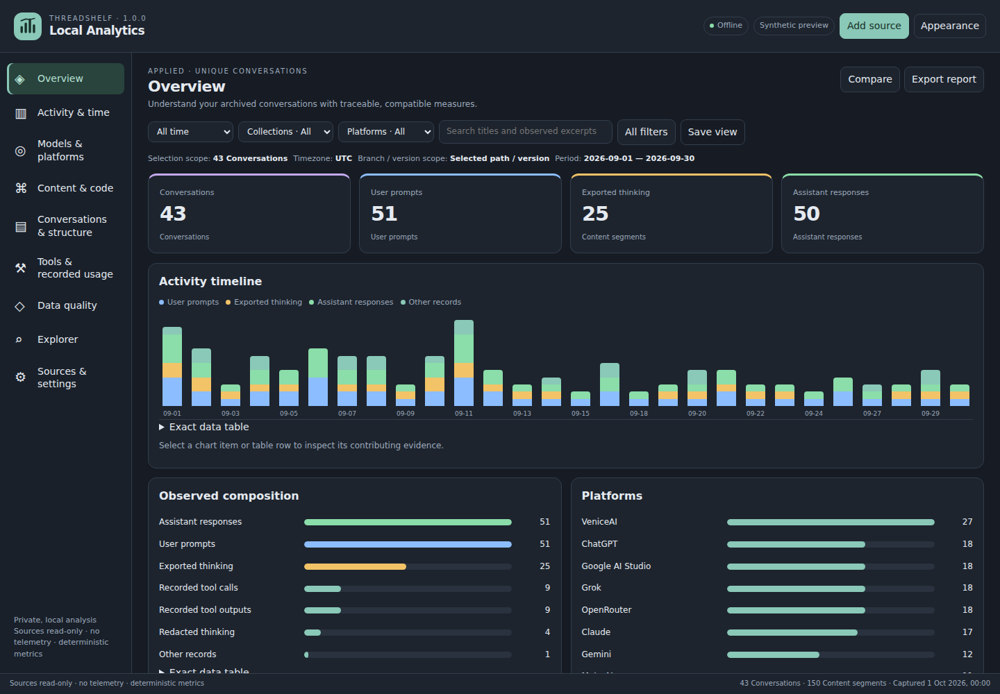

## Explorer: distributions and sequences

Explorer families describe particular populations and denominators. The [distributions guide](../Analytics/04-Explorer-Distributions.md) and [sequence guide](../Analytics/05-Explorer-Sequences.md) explain eligibility, buckets and boundaries.

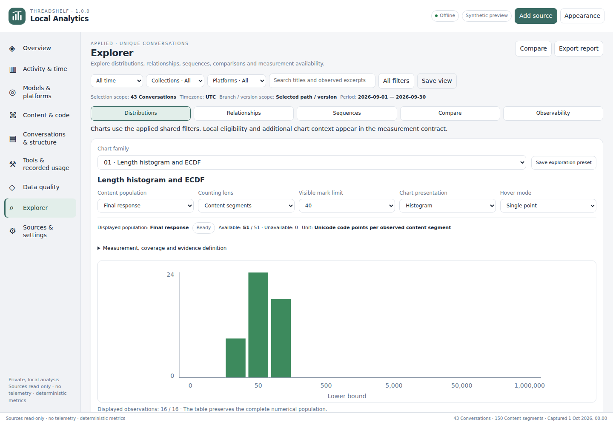

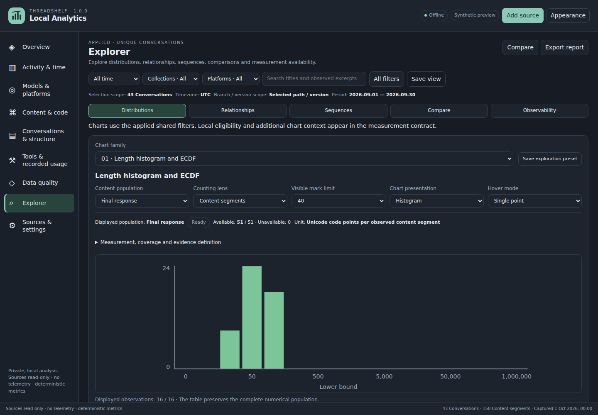

## Relationships: inspect contributors

Pairwise displays connect dimensions within the selected population. Use evidence to inspect the records behind a cell; a visual association is not proof of causation.

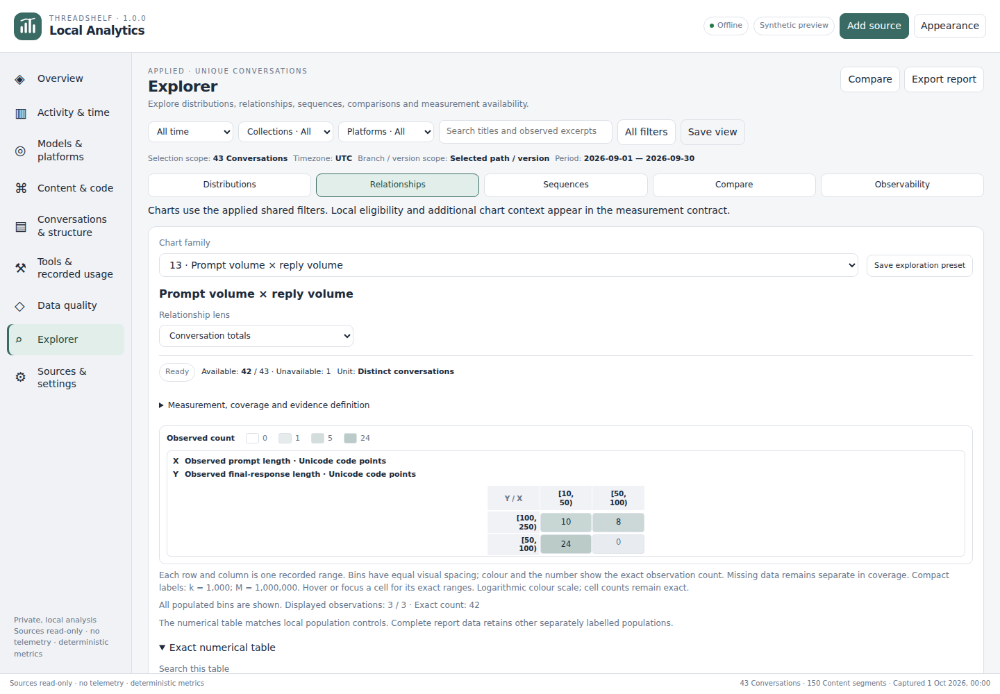

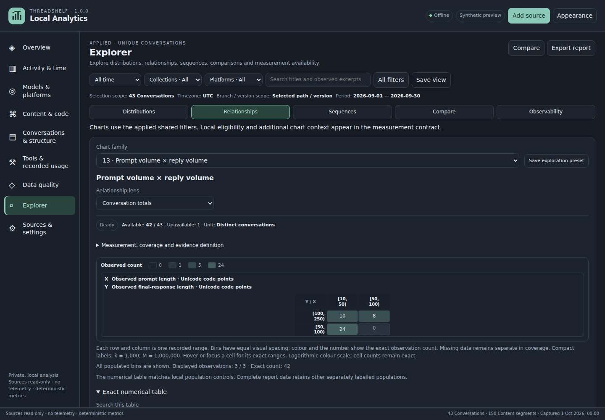

## Evidence: return to records

The evidence workspace retains the selected population and supports reviewing the contributors to a result. Full-body access depends on the source capture and content setting.

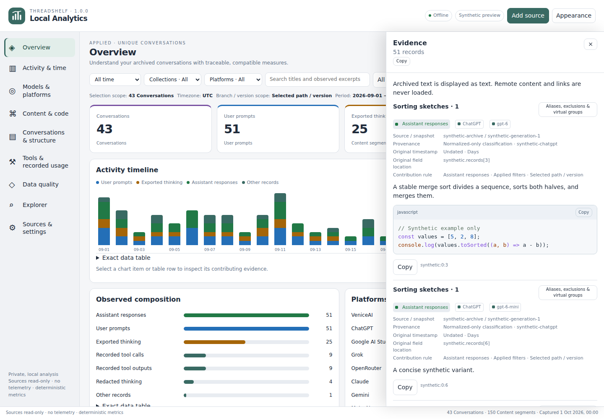

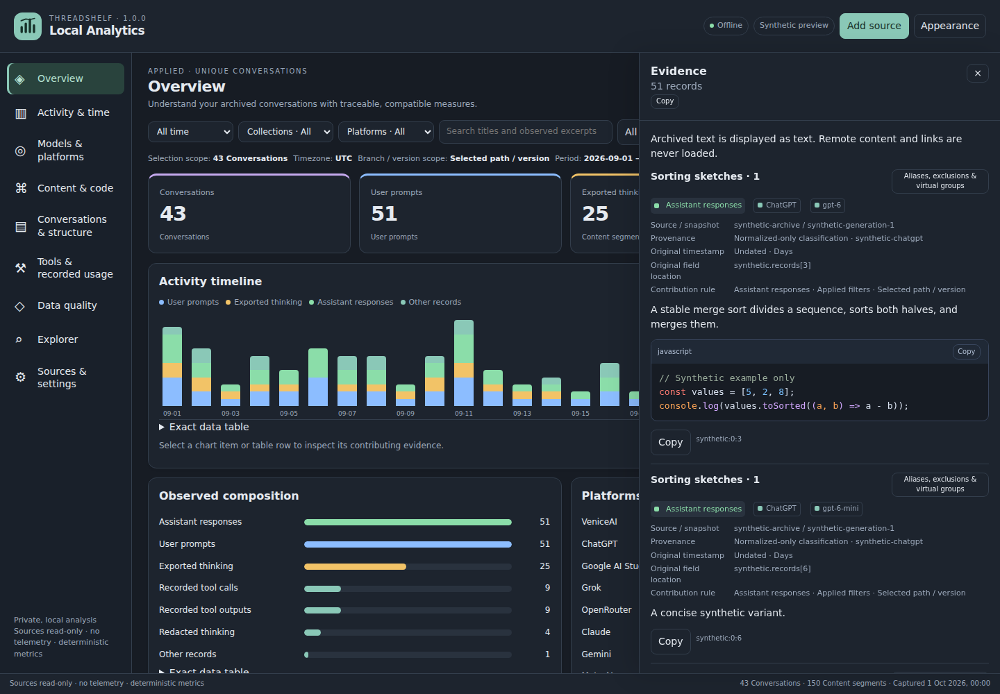

## Settings and appearance

Settings control source access, content handling and presentation. Settings are not a substitute for selecting and applying an analysis scope. See the [settings reference](../Analytics/07-Settings-and-Storage.md).

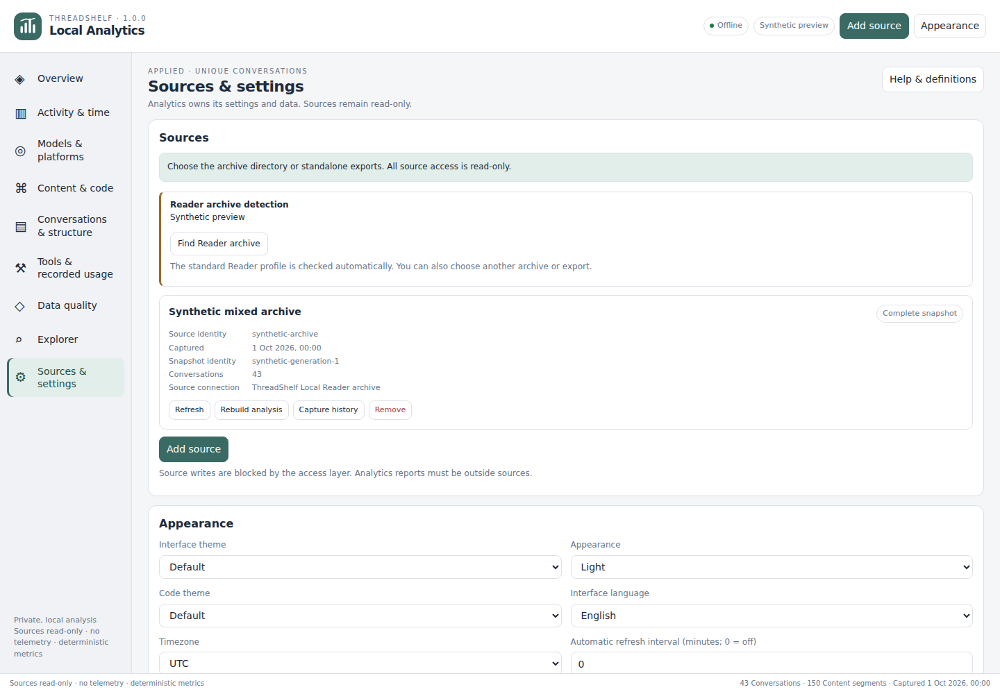

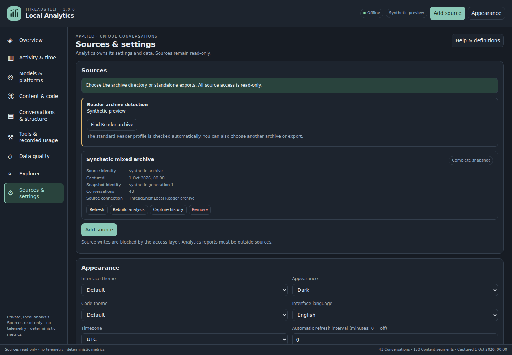

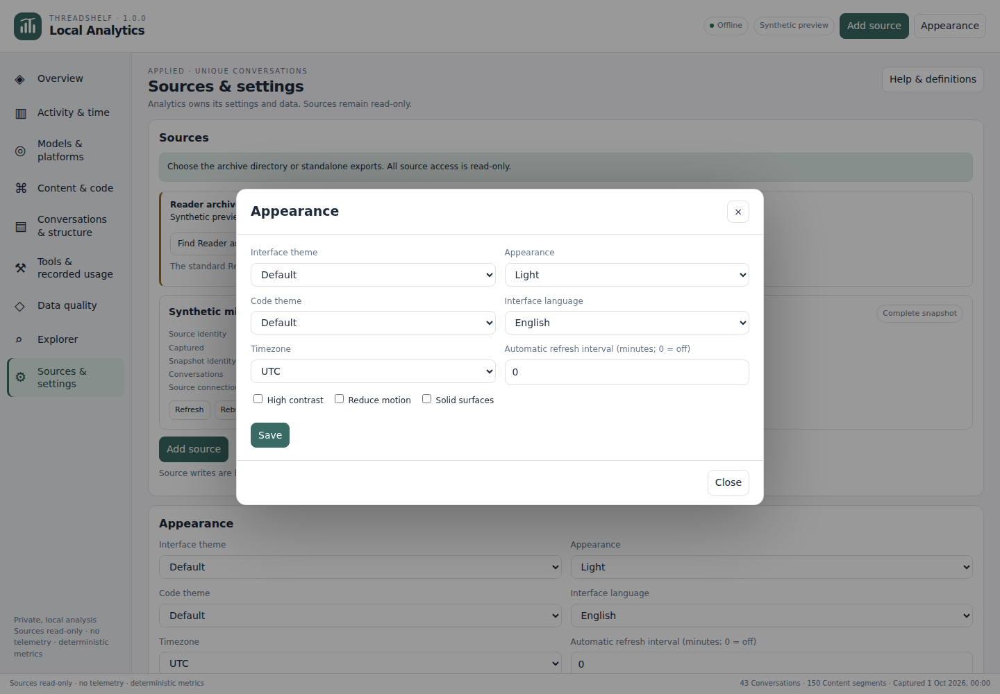

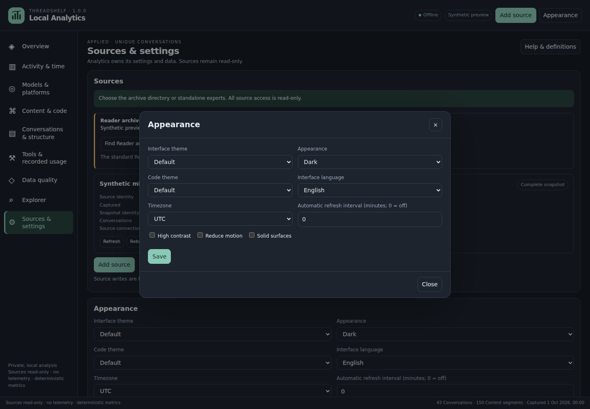

## Compact density

The compact layout keeps the real controls and counts available in less vertical space.

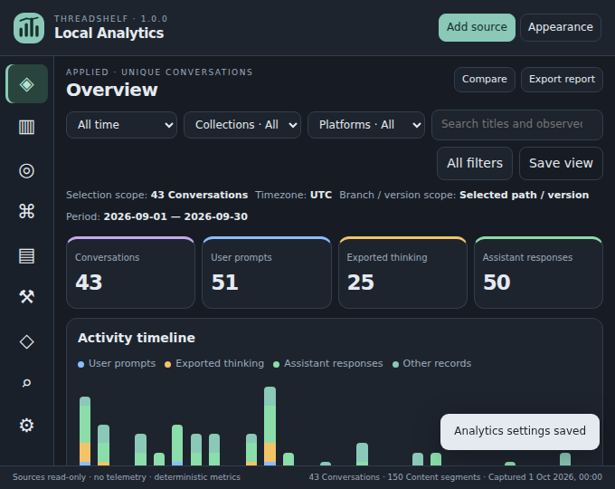
