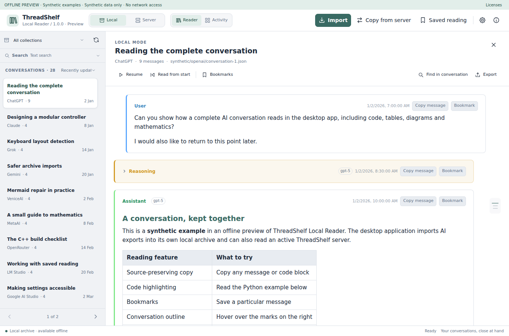
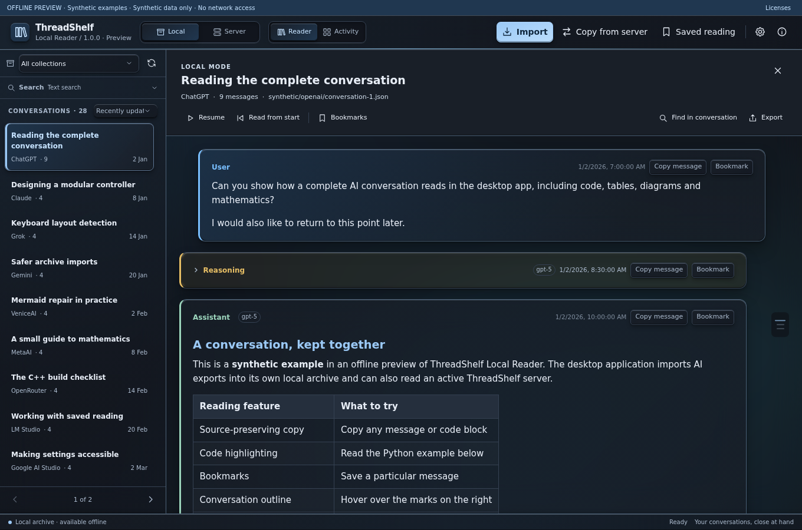
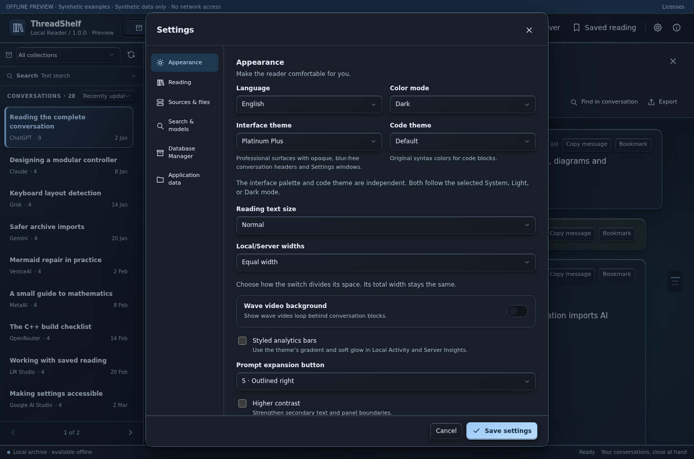
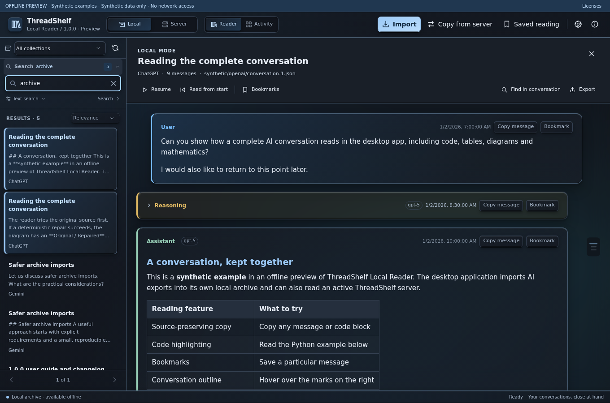
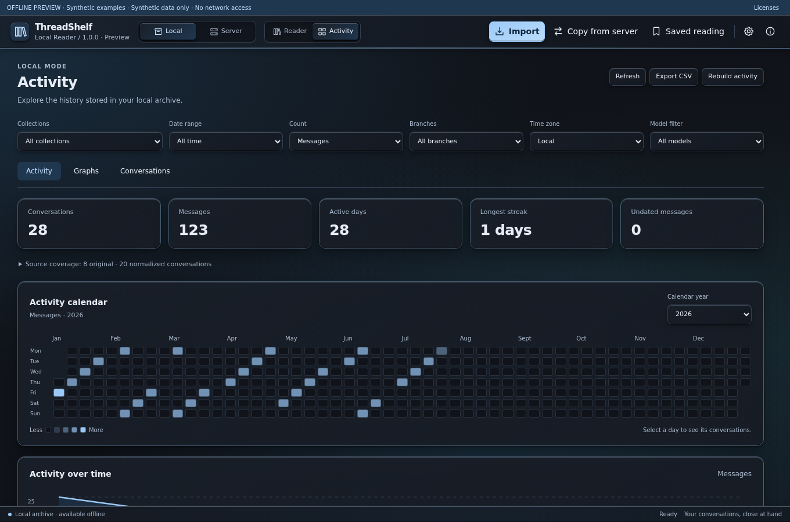
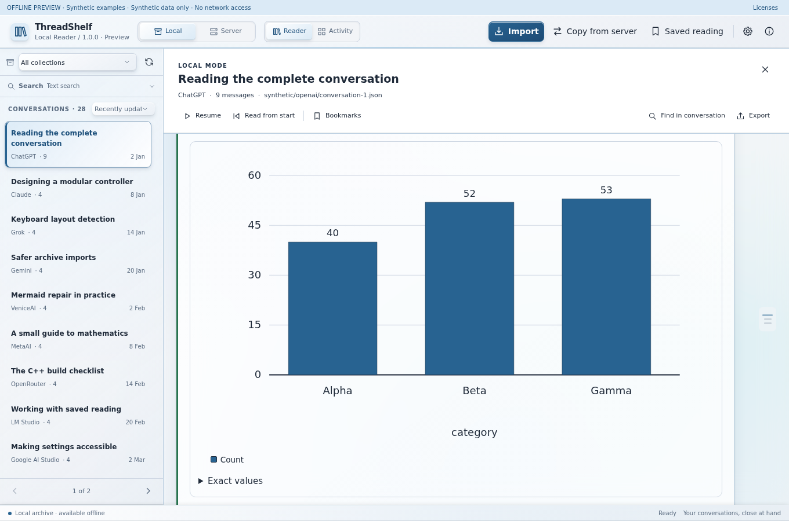
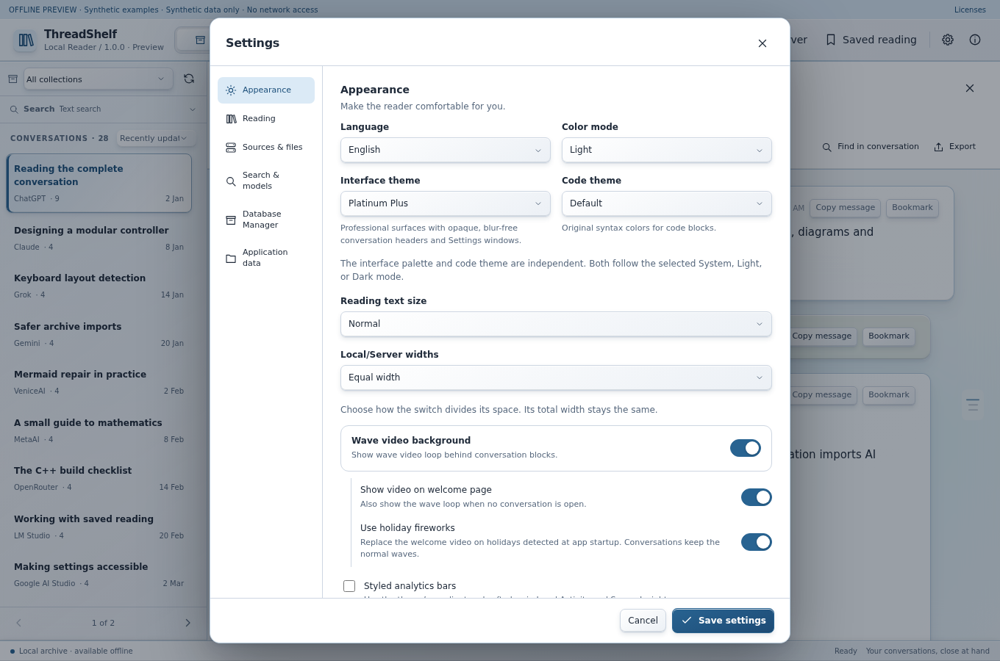
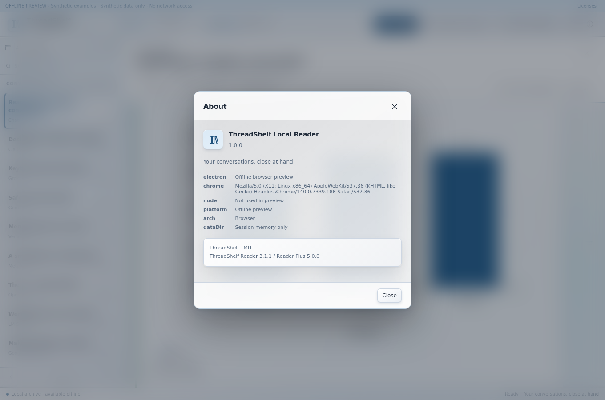

# Local Reader 1.0.0 — screenshot guide

These new 1360 × 900 screenshots show the exact production 1.0.0 renderer in the explicitly labelled synthetic offline browser preview. Native file operations, live server calls and model operations are simulated in that preview; the images demonstrate the controls and rendering, not successful native/server execution. They are unaltered captures of real application UI.

## Library and conversation: light and dark

The header selects Local or Server. The conversation shelf, collections and reading pane provide the main workflow. Theme choices preserve the same content and controls.

## Settings: sources and appearance

Settings control the source URL, local storage, models and presentation. Save changed preferences where the form provides a Save action. Read the dedicated [appearance](../Reader/appearance.md), [storage](../Data/storage.md) and [server](../Reader/server.md) chapters before changing paths or connections.

## Search: scope and evidence

A search combines the selected source, collection, query mode and filters. Results lead back to their conversations. Counts may represent matching passages rather than unique threads. The preview shown here uses synthetic search responses.

## Activity

Reader Activity and Server Insights summarize the selected source. Their scope and available data differ from a separately imported Analytics capture.

## Rich reading

The production renderer displays supported code, math, diagrams and cards from a sample conversation. Exports can omit original assets or contain unsupported payloads; a placeholder is preferable to an invented image or chart.

## Holiday controls

The screenshot shows the real dependent settings for optional holidays and appearance. It does not demonstrate a video playing. See [holidays](../Reader/holidays.md) for schedules, visibility and reduced-motion behavior.

## About and version

Use About when preparing a support report. The public application version is 1.0.0; internal storage schema labels can legitimately use different numbers.

The footer lists the inherited rendering adapters and their own source versions; those attribution numbers are independent of Local Reader’s public version at the top.

